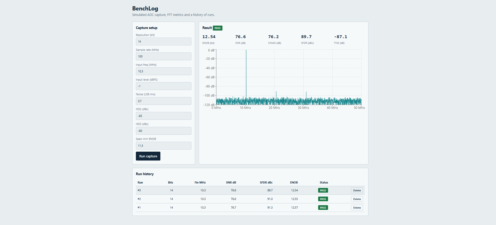

# BenchLog


A small full-stack tool for characterizing a simulated ADC. It generates a capture,
runs a 4096-point FFT, computes SNR, SINAD, SFDR, THD and ENOB, checks the result
against a spec limit, and keeps a history of runs in a database.



## Features

- Simulated ADC capture with configurable resolution, sample rate, input level,
  noise and harmonic distortion (HD2, HD3)
- FFT-based dynamic performance metrics with coherent sampling
- Pass/fail check against a minimum ENOB spec
- REST API with SQLite storage (SQLAlchemy)
- React + TypeScript interface with a spectrum plot and run history
- Automated tests for the signal processing code and the API

## Tech stack

| Layer             | Tools                             |
| ----------------- | --------------------------------- |
| Signal processing | Python, NumPy                     |
| Backend           | FastAPI, SQLAlchemy, SQLite       |
| Frontend          | React, TypeScript, Vite, Recharts |
| Testing           | pytest                            |

## Getting started

### Backend

```powershell
python -m venv .venv
.venv\Scripts\Activate.ps1
pip install -r backend\requirements.txt
cd backend
python -m uvicorn app.main:app --reload
```

The API runs at http://127.0.0.1:8000 and interactive docs are at `/docs`.

### Frontend

```powershell
cd frontend
npm install
npm run dev
```

Open http://localhost:5173. Vite proxies `/api` requests to the backend.

### Tests

```powershell
cd backend
python -m pytest -v
```

## API

| Method | Path                      | Description                                 |
| ------ | ------------------------- | ------------------------------------------- |
| POST   | `/api/runs`               | Run a capture, store and return the metrics |
| GET    | `/api/runs`               | List runs, newest first                     |
| GET    | `/api/runs/{id}`          | Get one run                                 |
| GET    | `/api/runs/{id}/spectrum` | Spectrum of a run in dBFS                   |
| DELETE | `/api/runs/{id}`          | Delete a run                                |

## How the metrics are computed

The input tone is placed on an odd FFT bin so the capture is coherent and needs no
window. Signal power is the fundamental bin, distortion is the sum of the aliased
harmonic bins (H2 to H6), and noise is everything that remains except DC.
ENOB is derived from SINAD and corrected for the input level:

```
ENOB = (SINAD - 1.76 + 20 log10(full_scale / amplitude)) / 6.02
```

An ideal 12-bit ADC with a near full-scale input gives an ENOB close to 12, which is
checked in the test suite.

## Project layout

```
backend/    FastAPI app, DSP code, tests
frontend/   React + TypeScript app
docs/       Screenshots
```
